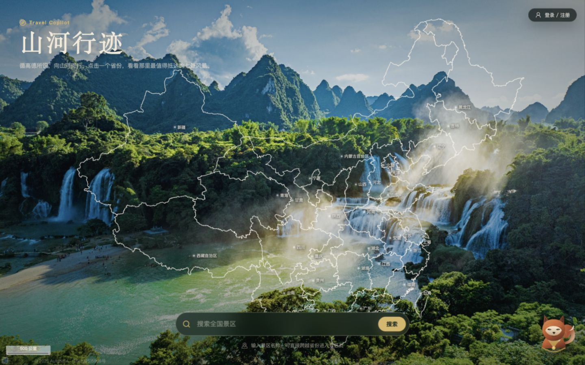
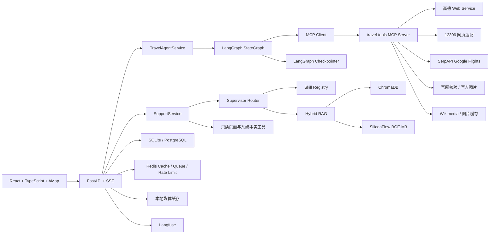

# Travel Copilot 山河行迹

一个面向中国境内旅行前规划的 **地图优先全栈 Agent 项目**。用户从中国地图下钻到省份热门景区，查看景区资料与官网核验结果，再根据出发地、日期、天气和交通数据生成出行方案；页面右下角的小狐狸 Agent 负责解释功能、排查故障和读取当前页面上下文。

项目重点不是“让大模型自由聊天”，而是展示如何在真实业务中实现：

- LangGraph 有界工具调用与可恢复状态
- MCP 标准化工具平面
- 高德、12306、航班、官网和图片多来源数据融合
- SSE 渐进式页面加载与后台任务
- Supervisor + Skill + Hybrid RAG 客服
- Langfuse 可观测性与可重复评测

> 项目定位为个人作品与 Agent 工程实践，不是面向公网大规模用户的生产 SaaS。项目不提供购票、付款、酒店预订或旅行中的实时导航。

## 快速预览



```text
中国地图
  → 选择省份
  → 7 个带名称的热门景区点位
  → 景区详情、官网核验、天气与高质量图片
  → 出发地与日期规划
  → 驾车距离、铁路余票时段、航班比较与旅行祝语
  → 小狐狸解释当前页面、图片、交通与故障
```

## 核心能力

### 地图与景区发现

- 使用 React + 高德 JS API 绘制中国省级版图和省内地市边界。
- 省份内展示 7 个带名称的热门景区光点，处理点位偏移和标签避让。
- 高德召回候选池，DeepSeek 在真实候选内按山水、人文或均衡偏好排序。
- 鼠标悬停即可预加载景区后台任务，点击后通过 SSE 渐进读取结果。

### 景区资料与可信图片

- 景区基础 POI、地址、评分和电话来自高德。
- 官网核验使用 Playwright 只读访问公开页面；失败时明确显示“待官方确认”，不伪造信息。
- 主图优先实体匹配度高的公开图片；画廊优先官方文旅、景区官网和高德图片。
- 图片经过缓存、尺寸检查、感知哈希去重和视觉模型语义筛选。

### 旅行前交通规划

- 驾车距离、时间和路线来自高德。
- 铁路数据来自 12306 公开网页适配，聚合为余票时段，不展示具体车次和购买入口。
- 长途或无合适直达铁路方案时，可按策略比较 SerpAPI Google Flights 航班结果。
- 日期和天数可以留空，Agent 会结合天气选择建议日期，并按默认天数评估。
- 最终方案经过确定性可行性校验，避免模型推荐不存在或不合适的交通方式。

### 小狐狸客服 Agent

- 规则快速命中，低置信度时使用结构化 LLM 意图分类。
- Supervisor 将问题路由到网站向导、故障助手或行程解释员。
- 每个角色拥有独立 `SKILL.md`，支持热加载和按路由注入。
- Hybrid RAG：SiliconFlow `BAAI/bge-m3` Embedding + ChromaDB + 关键词召回 + RRF。
- 仅调用只读白名单工具，不读取其他用户数据，不展示 API Key、Cookie 或内部 Prompt。

### 工程可靠性

- LangGraph 最大 12 个模型轮次、24 次工具调用、60 秒超时、最多 2 次重规划。
- 工具参数、工具结果和最终结果均进行 Schema / Validator 校验。
- Redis 令牌桶限流、熔断、半开探测、重试、任务队列和断线事件回放。
- SQLite 用于本地运行，PostgreSQL + Redis Streams 用于 Compose 部署。
- Langfuse 可选记录 Agent、LLM Generation、MCP Tool、图片视觉评分和任务 Score。

## 系统架构



## Agent 工作流

旅行主 Agent 使用显式 LangGraph：

```text
START
  ↓
agent：DeepSeek 选择下一步
  ↓
tools：白名单执行 + 参数校验 + 结果校验
  ↓
policy_gate：交通方式与航班门控
  ↓
agent：继续查询或提交结果
  ↓
validate_final：最终 Schema 与可行性校验
  ↓
finalize / fail
```

模型只负责受限决策和自然语言生成；路线、票价、余票、天气、来源和最终结构由确定性代码控制。

## RAG 

客服 RAG 默认使用：

```text
Agent 路由过滤
→ 关键词召回
→ BGE-M3 向量召回
→ RRF 融合
→ Top-K 知识片段
→ DeepSeek 生成带引用回答
```


### 评测快照

| 评测 | 结果 |
|---|---|
| 100 条 RAG 回归集 | Recall@5 99.0%、Faithfulness 97.9、Citation 99.5、Relevance 96.1 |
| 最终 50 条未见 Holdout 首次运行 | Recall@5 100%、Faithfulness 97.0、Citation 98.9、Relevance 94.8 |
| Runtime 300 | 300/300，包含 35 条真实在线 E2E |
| 客服盲测 v5 | Supervisor 路由 78/80，关键误路由 0，端到端 20/20 |

评测报告默认生成到 `data/evaluations/`。

## 技术栈

| 层级 | 技术 |
|---|---|
| 前端 | React 19、TypeScript、Vite、React Router、TanStack Query、Zustand、Tailwind CSS |
| 地图 | 高德 JS API、DistrictSearch、Marker、Polygon、Polyline |
| API | FastAPI、Pydantic v2、SSE Starlette、Uvicorn |
| Agent | LangGraph、OpenAI-compatible Tool Calling、DeepSeek |
| 工具协议 | MCP Python SDK，stdio / SSE / Streamable HTTP |
| 数据 | SQLite、PostgreSQL、Alembic、Redis、ChromaDB |
| 检索 | SiliconFlow `BAAI/bge-m3`、关键词检索、RRF |
| 浏览器能力 | Playwright、Playwright Chromium |
| 可观测性 | Langfuse、Agent Run JSON Trace、SSE 事件 |
| 测试 | pytest、pytest-asyncio、Vitest、Testing Library、Playwright E2E |

## 目录结构

```text
Traveling/
├── backend/app/
│   ├── agent/                 # LangGraph、工具、交通策略与校验
│   ├── attractions/           # 景区后台任务与持久化事件
│   ├── evaluation/            # RAG、Runtime、客服与盲测
│   ├── mcp/                   # MCP Server / Client
│   ├── providers/             # 高德、12306、航班、官网、图片
│   └── support/               # 小狐狸 Supervisor、Skill、RAG
├── frontend/
│   ├── src/                   # React 页面、组件、SSE 与地图
│   └── public/                # 中国省界与本地地图背景
├── evals/                     # 冻结评测集与图片 Fixture
├── alembic/                   # 数据库迁移
├── scripts/                   # 构建、启动和评测入口
├── tests/                     # 后端测试
├── Dockerfile
├── compose.yaml
├── pyproject.toml
└── uv.lock
```

## 环境要求

- Python 3.11+
- [uv](https://docs.astral.sh/uv/)
- Node.js 22 + npm
- macOS、Linux 或 Docker

高德、DeepSeek、视觉模型和 SiliconFlow 需要真实 API Key。项目不会在缺少 Key 时自动使用模拟业务数据。

## 本地启动

### 1. 安装依赖

```bash
cp .env.example .env
./scripts/build.sh
```

`build.sh` 会执行：

```text
uv sync
Playwright Chromium 安装
npm ci
前端生产构建
```

### 2. 配置 `.env`

至少填写：

```dotenv
AMAP_WEB_SERVICE_KEY=
AMAP_JS_KEY=
AMAP_JS_SECURITY_CODE=
DEEPSEEK_API_KEY=
DEEPSEEK_BASE_URL=https://api.deepseek.com
DEEPSEEK_MODEL=deepseek-chat
```

如需完整图片、客服 RAG、航班和可观测性：

```dotenv
VISION_API_KEY=
VISION_BASE_URL=
VISION_MODEL=

SILICONFLOW_API_KEY=
SILICONFLOW_BASE_URL=https://api.siliconflow.cn/v1
SILICONFLOW_EMBEDDING_MODEL=BAAI/bge-m3

SERPAPI_API_KEY=

LANGFUSE_PUBLIC_KEY=
LANGFUSE_SECRET_KEY=
LANGFUSE_BASE_URL=https://cloud.langfuse.com
```

完整变量说明见 [`.env.example`](.env.example)。

### 3. 启动

```bash
./scripts/start.sh
```

打开 <http://127.0.0.1:8765>。

本地默认使用 SQLite 和进程内任务。配置 `REDIS_URL` 和 PostgreSQL 后，可使用持久化任务队列和独立 Worker。

## 前端开发模式

终端一：

```bash
uv run uvicorn backend.app.main:app \
  --host 127.0.0.1 \
  --port 8765 \
  --reload \
  --reload-dir backend
```

终端二：

```bash
cd frontend
npm run dev
```

访问 <http://127.0.0.1:5173>。Vite 会将 `/api` 和 `/media` 代理到 `8765`。

## Docker Compose

启动 API、Worker、PostgreSQL 和 Redis：

```bash
cp .env.example .env
docker compose up --build -d
```

查看状态：

```bash
docker compose ps
docker compose logs -f api worker
```

数据库迁移：

```bash
uv run alembic upgrade head
uv run alembic downgrade -1
```

本地 HTTP 使用 `COOKIE_SECURE=false`；通过 HTTPS 部署时应改为 `true`。

## 主要 API

| 接口 | 用途 |
|---|---|
| `GET /api/health` | 服务、数据库、Redis 与配置状态 |
| `GET /api/map/provinces` | 省级地图数据 |
| `GET /api/provinces/{adcode}/attractions` | 省内 7 个热门景区 |
| `POST /api/attractions/{poi_id}/prepare` | 预热景区后台任务 |
| `GET /api/attractions/{poi_id}/stream` | 景区资料 SSE |
| `GET /api/transport/stream` | 交通规划 SSE |
| `GET /api/support/stream` | 小狐狸客服 SSE |
| `GET /api/agent/runs/{run_id}` | Agent Run Trace |
| `GET /api/agent/graphs/{thread_id}` | LangGraph Checkpoint |

完整接口可通过启动后的 `/docs` 查看。

## 测试

```bash
uv run pytest -q

cd frontend
npm test
npm run build
```

部署后执行真实在线评测：

```bash
uv run python scripts/evaluate_travel_v2.py \
  --base-url http://127.0.0.1:8765

uv run python scripts/evaluate_runtime300.py \
  --base-url http://127.0.0.1:8765
```

RAG 质量

```bash
uv run python scripts/evaluate_rag_quality.py \
  --cases evals/runtime300/rag_100.jsonl \
  --expected-cases 100 \
  --concurrency 5

uv run python scripts/evaluate_rag_quality.py \
  --cases evals/rag_final_holdout/rag_final_holdout_50.jsonl \
  --expected-cases 50 \
  --concurrency 5
```


## 数据来源与边界

- 高德：POI、行政区、天气和驾车路线。
- 12306：公开网页适配查询，并非官方开放 API，页面结构或反爬策略变化可能影响结果。
- SerpAPI Google Flights：长途航班参考价格、耗时和转机信息。
- 官网与官方文旅页面：开放时间、票价和代表性图片。
- Wikimedia Commons：高清公共图片及实体匹配回退。

项目不会：

- 自动购票、付款或预订酒店
- 登录 12306、OTA 或第三方账户
- 绕过验证码、访问限制或反爬机制
- 抓取小红书、知乎等社区正文
- 在旅行过程中提供实时导航

## 已知限制

- 外部数据源可能限流、改版或短时不可用。
- 最终盲测 46/50 条严格达标，剩余问题主要来自知识文档缺乏解释性内容。
- RAG 质量优化提高了调用成本，最终 Holdout 的 p95 约 68.9 秒。
- 项目面向个人和少量邀请账户，不包含公网多租户运营能力。

## 安全

- 不要提交 `.env`、数据库、媒体缓存、ChromaDB、虚拟环境或前端构建产物。
- 账户密码使用 PBKDF2 哈希，登录使用 HttpOnly `SameSite=Lax` 会话 Cookie。
- 客服只执行只读白名单工具，并按账户隔离会话。
- API Key、Cookie、Token、内部 Prompt 和完整异常堆栈不会返回给前端。


## License

本项目使用 [MIT License](LICENSE)。
